# KN5 Garage

Turn Assetto Corsa car mods (`.kn5`) into files for **Blender**, **game engines**, **3D viewers**
and **3D printers**, from a browser-based app that runs entirely on your PC.

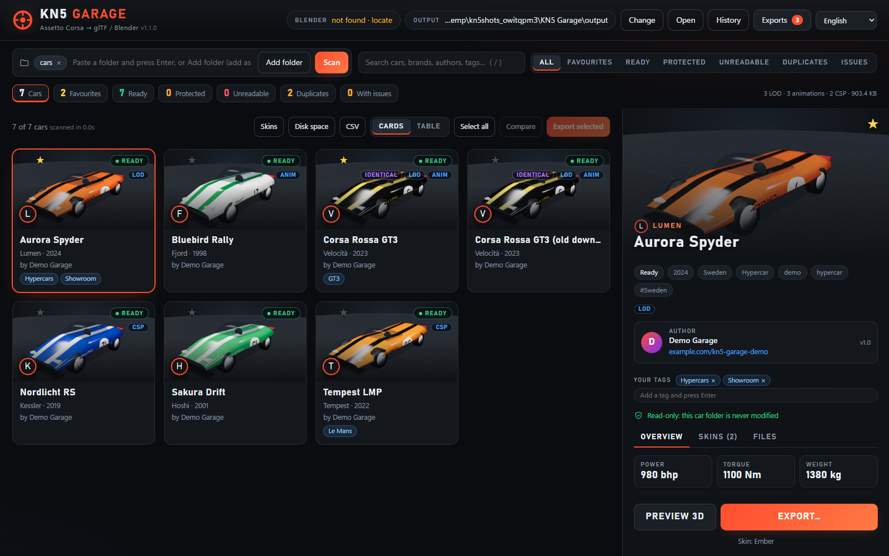

- Browse your whole car collection: previews, authors, specs, power curves, skins, CSP features.
- Export to **glTF (.glb)**, **OBJ**, **FBX** (through Blender) or **STL**, with presets for
  Blender renders, game engines and 3D printing, a new paint colour and headlights on.
- Look at any car in 3D first: paint colours, steering, lights, day / night studios,
  animations, measuring, and save pictures, turntables and videos.
- Open exports in Blender with a ready-made studio scene.
- In 13 languages: English, Deutsch, Español, Français, Italiano, Polski, Português, Türkçe,
  Русский, العربية (right to left), 日本語, 한국어 and 中文.
- Your car folders are never changed, and nothing leaves your computer.

*The cars in these pictures are fictional demo cars made by `tools/make_demo_garage.py`.
A web version of this page with all pictures: [README.html](README.html).*

## Download and run

**Windows, no install:** download `KN5Garage-<version>-windows.zip` from the
[Releases](../../releases) page, unzip it anywhere, and double-click **`KN5Garage.exe`**. It opens
the app in your browser. Keep its small console window open while you use the app; close it to quit.
Settings and exports are kept next to the `.exe` (in `settings.json`, `library.json` and `output\`).
Each release lists a SHA-256 checksum for the zip.

**From source (Windows, macOS, Linux):**

1. Install Python 3.9 or newer from python.org (on Windows tick "Add Python to PATH").
2. Download this project and double-click **`KN5 Garage.bat`** (Windows), or run
   `python -m pip install -r requirements.txt` then `python app.py`.

## Pictures

| | |
|---|---|
| 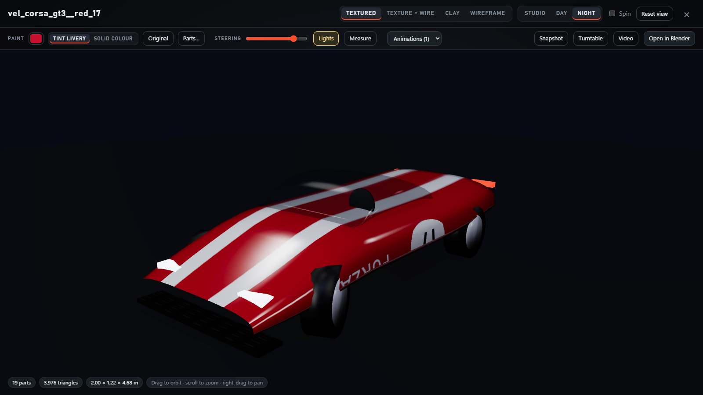 | 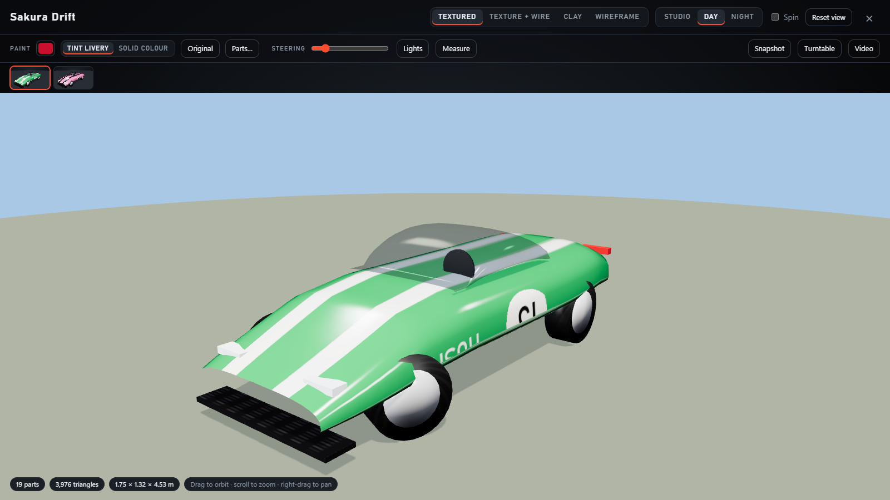 |
| **Night studio**, lights on, steering turned | **Day studio** and the skin strip |
| 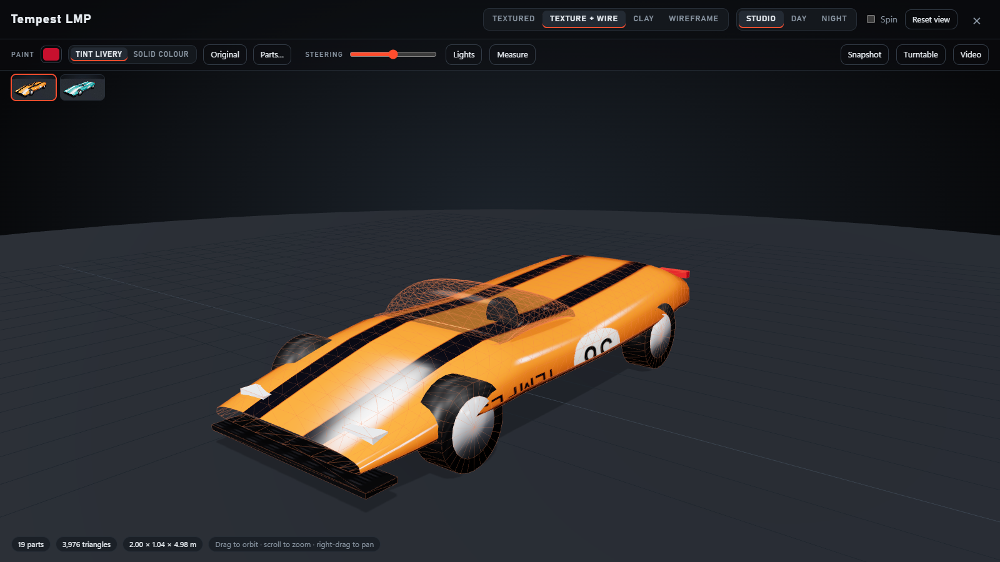 | 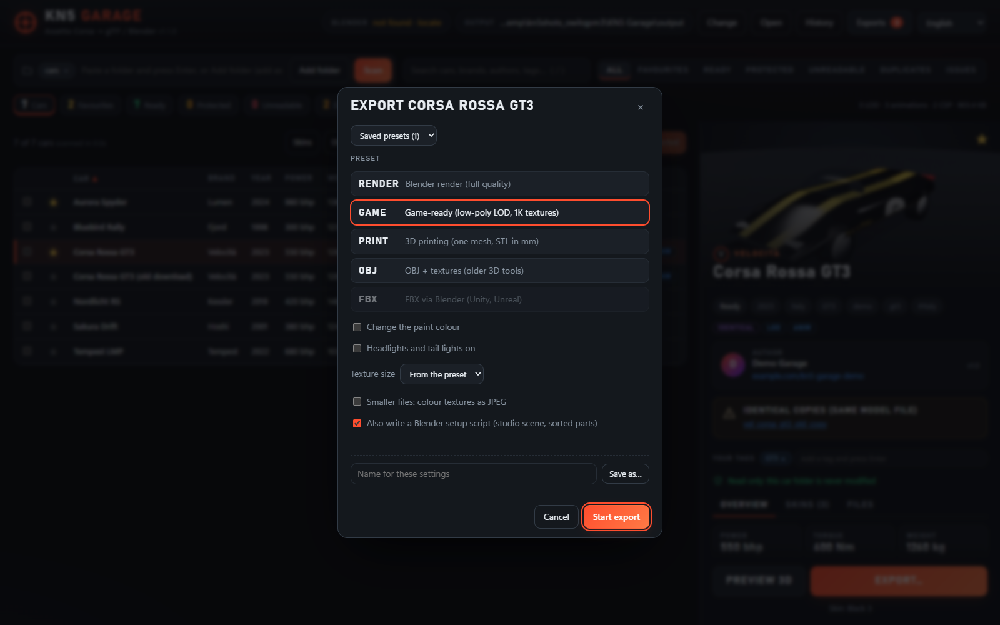 |
| **Texture + wireframe** view | **Export**: presets, paint, lights, textures, saved presets |
| 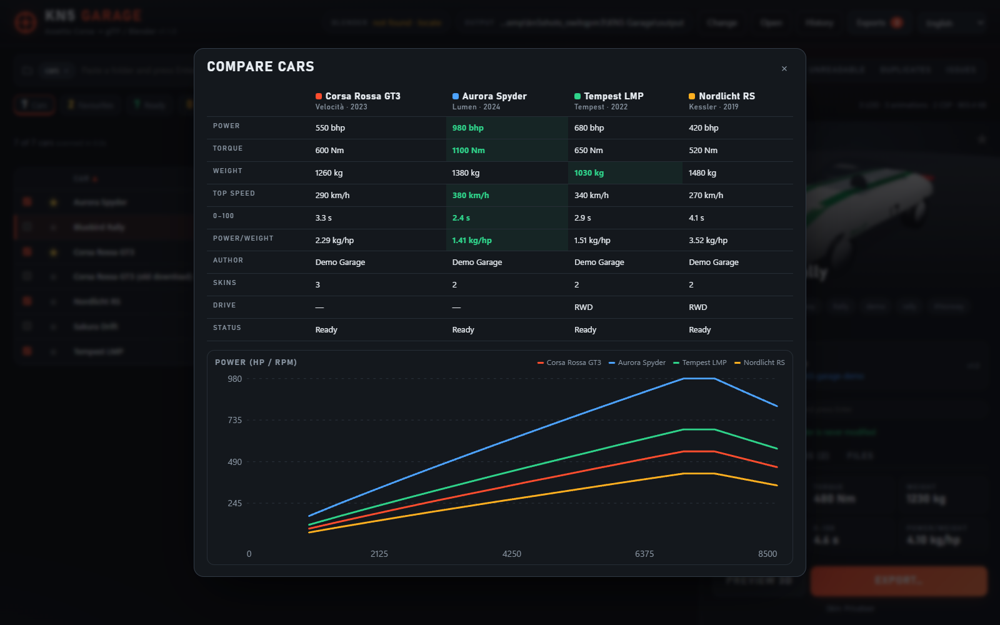 | 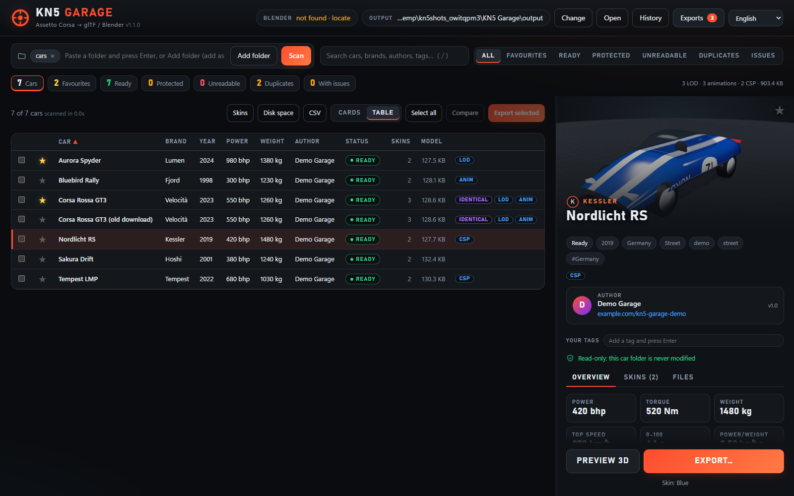 |
| **Compare** up to six cars | **Table** view, sortable by any column |
| 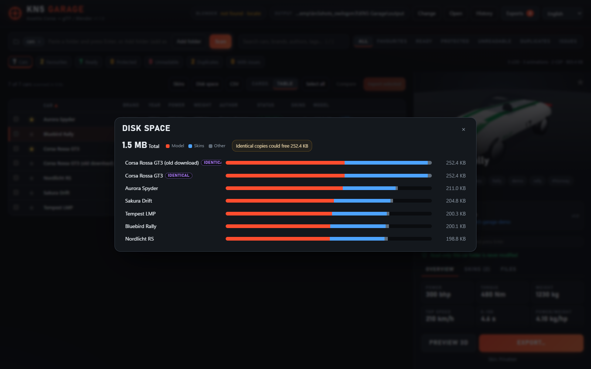 | 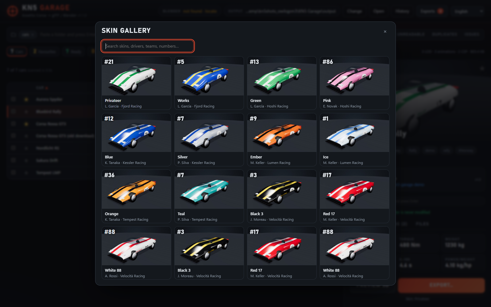 |
| **Disk space** and identical copies | **Skin gallery** across all cars |
| 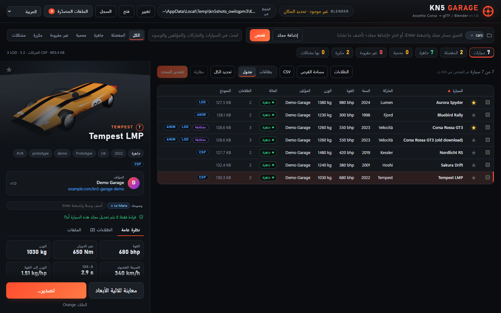 | 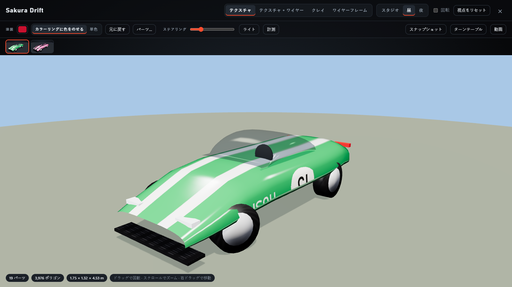 |
| **13 languages**, Arabic right to left | Japanese |
| 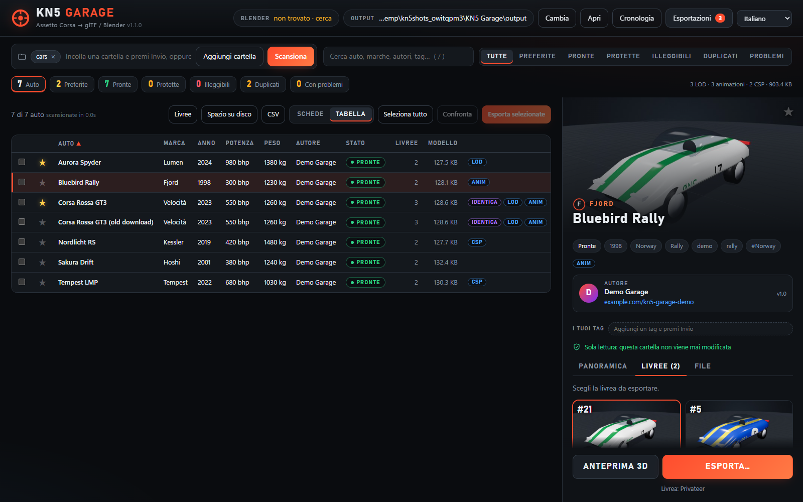 | |
| Italiano | |

## Using the app

### Library

- **Folders:** add as many as you like with **Add folder**, or paste a path and press Enter:
  single cars, your `...\content\cars` folder, mod folders anywhere. **Scan** reads them together;
  rescans are fast because unchanged cars come from a cache.
- **Cards or Table**, sorted by any column. The stats bar counts Favourites / Ready / Protected /
  Unreadable / Duplicates / With issues; click a count to filter. Press `/` to search; your own
  tags are searched too.
- **Favourites and tags:** click the ★ on a car, and add your own tags in its details.
- **Duplicates:** *Identical* marks copies of the same model file even under other names;
  *Duplicate* marks cars with the same name. **Disk space** shows what each car uses and how much
  removing identical copies would free.
- **Skin gallery:** every skin of every car in one grid; search by name, driver, team or number.
- **Details:** brand, year, author and website, specs, power/torque chart, description, skins,
  files, issues, **Custom Shaders Patch** features, real numbers from an unpacked `data` folder
  (mass, drive, gears, limiter, turbo), and Content Manager *variant of* links.
- **Compare** 2 to 6 ticked cars: a spec table with the best values highlighted and power curves.
- **CSV** saves the cars shown as a spreadsheet.

### Exporting

**Export…** (one car, or tick several and **Export selected**) offers:

| Preset | Gives you |
|---|---|
| **Render** | Full-quality `.glb` for Blender: clearcoat paint, `txMaps` as metallic/roughness, glass, chrome and carbon materials, part pivots, `.ksanim` animations, and the driver rigged when its bones are in the model. |
| **Game** | The car's lower-detail LOD model with 1K textures. |
| **Print** | One STL mesh in millimetres, Z up, for slicers. |
| **OBJ** | `.obj` + `.mtl` + a textures folder, for older 3D tools. |
| **FBX** | Made by Blender in the background (textures embedded), for Unity and Unreal. Needs Blender. |

Options: **paint colour** (tint the livery or a solid colour; choose the paint parts in the 3D
viewer if the automatic guess is wrong), **headlights and tail lights on**, **texture size**,
**JPEG textures** for smaller files, and a **Blender setup script**. Save combinations as
**saved presets**. Running exports can be cancelled. After each export a report lists what was found
and any problems, and **History** keeps past exports with an **Again** button.

### 3D viewer

**Preview 3D** shows any car straight from its folder (no export needed), with a skin strip;
**View 3D** opens an export. Drag to orbit, scroll to zoom, right-drag to pan.

- Textured, texture + wireframe, clay or wireframe; **studio**, **day** or **night** lighting with shadows.
- **Paint** colours, and **Parts…** to choose which parts are paint (click parts on the car).
- **Steering** slider (front wheels and steering wheel), **Lights** on/off, **Animations** (doors, wipers…).
- **Measure**: click two points for the distance. Hovering shows each part's name and material.
- **Snapshot** (1920×1080), **Turntable** (36 pictures) and **Video** (8-second WebM) save to `output\renders\<car>\`.

### Blender

The top bar shows whether Blender was found (click it to locate `blender.exe`). **Open in Blender**
imports the car, sorts parts into Body / Wheels / Interior / Glass / Lights, adds a ground, studio
lights and a camera, and saves a `.blend` next to the export. The setup script also works on its
own: in Blender, Scripting > Open > Run Script (keep it next to the `.glb`).

### Links

The address can open the app in a given state, handy for bookmarks:
`http://127.0.0.1:8642/#car=<folder name>&tab=skins`, `#open=compare&select=a,b`,
`#car=<id>&viewer=preview&studio=night&lights=1`.

## Command line

`convert.bat`, `python kn5_to_glb.py`, or `KN5Garage.exe convert` convert one car or a whole folder:

```
KN5Garage convert <folder> [-o OUTPUT] [--skin SKIN_NAME | --skin none] [--preset render|game|print|obj|fbx]
                           [--paint #c8102e] [--paint-mode tint|solid] [--texture-size 1024]
                           [--jpeg 85] [--lights-on] [--keep-normal-green]
```

Files are named `<car>__<skin>.glb`, or `<car>.glb` when no skin is used; other presets add
`__game`, `__print`, `__obj` or `__fbx`.

## Privacy and security

- The app is a small web server that only listens on `127.0.0.1`; other computers can't reach it.
- Websites you visit can't control it: every request needs a random token that changes at each
  start, and cross-site requests, DNS-rebinding tricks and framing are blocked.
- The page loads nothing from the internet: three.js is bundled, there are no web fonts,
  analytics or update checks. Nothing is logged.
- Paths on screen start with `~` instead of `C:\Users\<your name>`, so screenshots and screen
  shares don't show your user name. Blender scripts written next to exports contain no paths.
- Your settings, favourites, tags, history and exports stay on your PC and are excluded from git.
- Mod files are treated as untrusted: damaged or hostile files only produce an error.

Details and how it is tested: [SECURITY.md](SECURITY.md).

## Your car folders are never changed

Car folders are only read. Exports go to the output folder, and the converter refuses an output
folder inside a car folder. The smoke test checks this by fingerprinting every file before and after.

## Protected cars

Some authors protect their cars: the `.kn5` keeps only placeholder textures, the real ones sit in an
encrypted block, and the surface data is scrambled. KN5 Garage marks these as **Protected**, names
the author, and exports the shape only. It does not try to break the protection.
Please respect mod authors: exports are for your own use unless the author allows more.

## Building and testing

- `run_tests.bat` runs everything: unit, security and web tests, then the end-to-end smoke test.
  Drag car folders onto it to include your own cars (they are only read).
- `build_exe.bat` builds `dist\KN5Garage.exe`; `python packaging/test_exe.py` checks it from a clean folder.
- `python tools/make_demo_garage.py` builds the demo cars; `python tools/screenshots.py` remakes the pictures.
- Pushing a tag like `v1.1.0` makes GitHub build, test and publish the `.exe` on a release.

See [CONTRIBUTING.md](CONTRIBUTING.md) for how the code is organised and the project rules.

## Known limits

- Encrypted model files can't be read; they're reported and skipped.
- AC's shaders don't map one-to-one onto PBR; `txMaps`, glass and chrome are close matches.
- The driver is rigged only when its bones are in the same model and the bind pose matches;
  otherwise it is exported as a static mesh (the report says so).
- Glass, chrome, carbon and lights are recognised by material names; use **Parts…** for paint.
- FBX needs Blender. Turntable and video use the browser's WebGL; videos are WebM.

## Licence and credits

KN5 Garage is released under the [MIT licence](LICENSE): you may use, copy, change and share it,
including in other projects, as long as the licence notice is kept.

Third-party software and trademarks: [THIRD_PARTY_NOTICES.md](THIRD_PARTY_NOTICES.md).
KN5 Garage is not affiliated with Kunos Simulazioni, 505 Games or the Blender Foundation.
